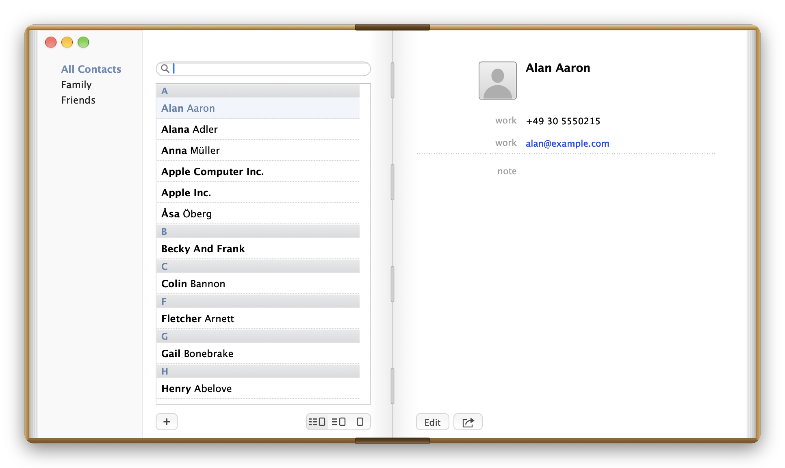
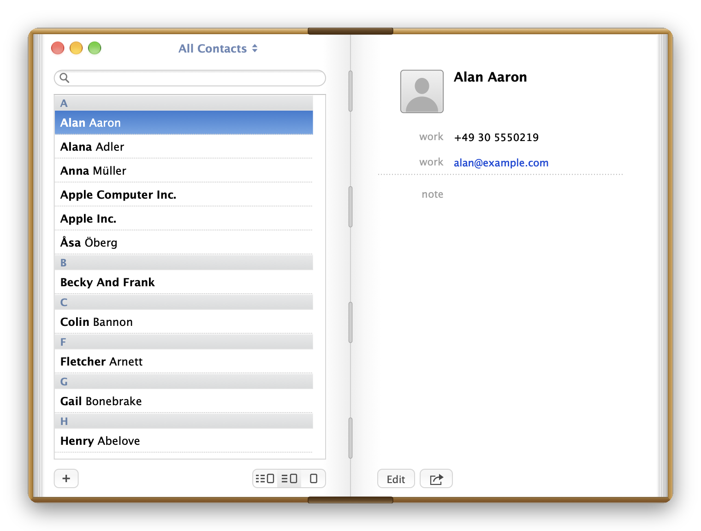
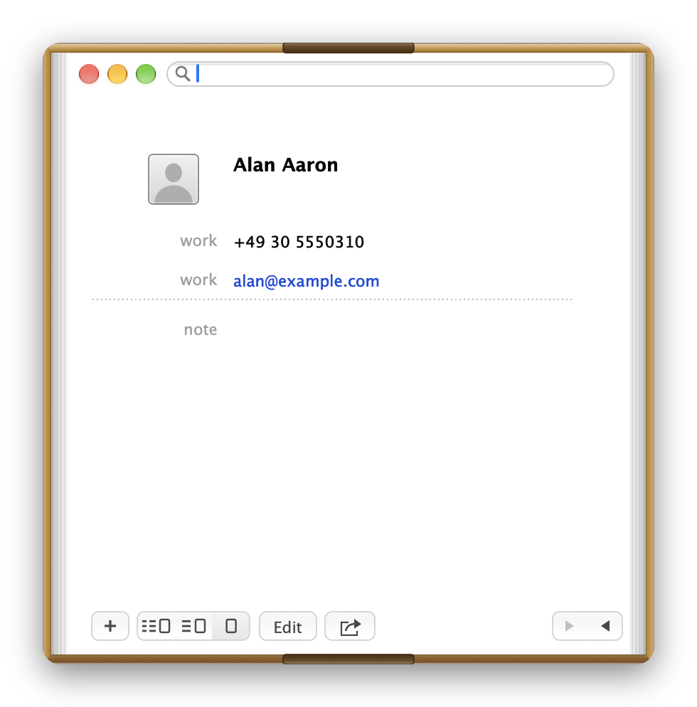

# RetroContacts

A native macOS contacts app in the style of the open, leather-bound **Address Book of OS X 10.8** – working with your **real system contacts** (Contacts.framework), not a mock-up.

<p align="center"></p>

> Swift 5 · AppKit · macOS 14 or later · Apple Silicon and Intel · English and German · GPL-3.0
>
> **Note:** RetroContacts is a non-commercial fan project, made out of respect for Apple. It is an independent project and is not affiliated with Apple Inc. The design is *inspired by* OS X 10.8. Apple, Mac, macOS, OS X and Mountain Lion are trademarks of Apple Inc.

## Features

- **Three views** – groups · list · card (⌘1), list · card (⌘2), card only (⌘3, page buttons at the bottom right).
- **Contacts** – view, create, edit, delete.
- **Search** – by name, company, phone number and e-mail.
- **Groups** – groups and smart groups; drag and drop contacts into groups.
- **vCard** – import and export, sharing, printing.
- **Settings (⌘,)** – sorting and display, and a **custom app icon** (PNG, exactly 256 × 256 pixels).
- **Privacy** – only the public Contacts.framework API, no network access, no private APIs; the app stays usable without contacts access.

## Screenshots

<table>
<tr>
<td></td>
<td></td>
</tr>
<tr><td align="center">List · card (⌘2)</td><td align="center">Card only (⌘3)</td></tr>
</table>

*All images show synthetic demo contacts (`--demo`), not real ones. Re-create them with `./docs/make-screenshots.sh`.*

## Installation

Download the signed and notarized DMG from the [latest release](../../releases), open it and drag the app to *Applications*. On first launch macOS asks once for access to **Contacts**.

## Build from source

```bash
./build.sh          # universal (arm64 + x86_64), ad-hoc signed → build/RetroContacts.app
./release.sh        # Developer ID + hardened runtime → notarize → DMG
```

`release.sh` needs a "Developer ID Application" certificate in the keychain and a `notarytool` profile (`NOTARY_PROFILE`, default `Retromac`). `SIGN_ID="Developer ID Application: …" ./build.sh` signs with hardened runtime and timestamp. The app is built with `swiftc` directly (no `Package.swift`).

## Testing

```bash
APP=build/RetroContacts.app/Contents/MacOS/RetroContacts
$APP --selftest                   # 34 automated checks: data handling, search, icon validation, performance
$APP --demo                       # run with synthetic demo data
$APP --demo --mode 0 --snapshot /tmp/x.png   # PNG of the window (also --select NAME, --search TEXT, --edit, --new, --prefs, --size WxH)
```

## Data & privacy

Contacts are read from and written to the system via Contacts.framework; nothing is copied into a private store. Contact notes are **not** read from the system (that needs a special Apple entitlement) and are kept locally in `~/Library/Application Support/RetroContacts/notes.json`. No network access, no logging of contact data. Details: [docs/COMPLIANCE.md](docs/COMPLIANCE.md).

## Limitations

- Minimum window sizes (three columns 680×420, two columns 520×380, card 370×340) are test values, not measured on the original.
- System notes of contacts are not shown or edited (see above).
- Not available in the Mac App Store; distribution is GitHub only.

## License & legal

- **Code:** [GNU General Public License v3.0](LICENSE) (GPL-3.0). Copyright © 2026 Maik Klotz.
- **Fan project:** RetroContacts is a non-commercial fan project, made out of respect and admiration for Apple and the design of OS X 10.8. It is free of charge, makes no claim to any Apple trademark, design or artwork, and is provided "as is" without warranty (GPL-3.0, sections 15–16). If you are a rights holder and have a concern, please open an issue – I will respond promptly and in good faith.
- **No affiliation with Apple:** RetroContacts is an independent open-source project, neither authorized nor endorsed by Apple. No Apple images, fonts, sounds or textures are included (everything is redrawn; *Lucida Grande* is only referenced from the installed system). Apple, Mac, macOS, OS X and Mountain Lion are trademarks of Apple Inc.
- **App icon:** `Resources/icon-source.png` and `AppIcon.icns` are AI-generated and are **not** covered by the GPL; all rights reserved. The icon resembles the former Apple Contacts icon, so forks should use their own – the *App icon* setting (PNG 256 × 256) exists for that. See [docs/COMPLIANCE.md](docs/COMPLIANCE.md).
- **Distribution:** GitHub only (source and notarized releases), not the App Store.
